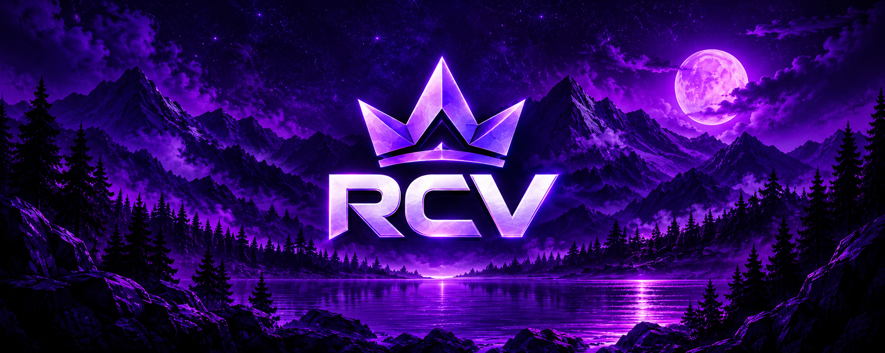

### ⚡ Minecraft: Java Edition on Android

**Your game. Your settings. Your RCV experience.**

**Target: v1.0.0** · **Development & testing in progress**

[Features](#-launcher-features) · [Installation](#-download--installation) · [Roadmap](#-v100-roadmap) · [Help](#-support--troubleshooting)

---

## 🎮 Welcome to RCV

**RCV Launcher** is an unofficial Android launcher for **Minecraft: Java Edition**, based on [Zalith Launcher 2](https://github.com/ZalithLauncher/ZalithLauncher2). It combines the upstream game engine with an RCV-branded dashboard and community shortcuts.

> [!IMPORTANT]
> **Project status:** RCV v1.0.0 is under development. Some features are inherited from the upstream engine, and the roadmap below describes goals rather than completed work. Check [GitHub Releases](https://github.com/CJ-RCV/RCV-L/releases) for actual APK availability.

## ✨ Launcher Features

<table><tr><td width="50%" valign="top">

### 🎮 Minecraft Java
Launch compatible Java Edition versions on Android.

### 📦 Version Manager
Browse, install, organize, and select game versions.

### 🧩 Mods & Loaders
Manage installed mods and use supported mod loaders, including Fabric and Quilt where compatible.

</td><td width="50%" valign="top">

### 🎨 Customization
Configure touch controls, resource packs, shaders, and available graphics settings.

### ⚡ Performance
Tune memory and renderer options for your device.

### 🏠 RCV Home
A dedicated RCV dashboard and community shortcuts.

</td></tr><tr><td valign="top">

### 📁 Game Files
Access saves, screenshots, and version management screens.

</td><td valign="top">

### 🛠️ Logs & Tasks
Existing task UI and crash-log viewing/sharing workflows.

</td></tr></table>

Availability varies by build, device, Minecraft version, and graphics renderer. Some features come from the upstream launcher.

## 📥 Download & Installation

1. Open [official GitHub Releases](https://github.com/CJ-RCV/RCV-L/releases).
2. Select a release and read its notes.
3. Download the Android APK from **Assets**, if available.
4. Install it and configure the launcher.
5. Install a compatible Minecraft version and select suitable controls and graphics settings.

> [!CAUTION]
> If a release has no APK asset, there is no APK to download from that release. Avoid unofficial APK mirrors.

<b>📱 System requirements — tap to expand</b>

| Component | Details |
|:--|:--|
| Android | 8.0+; compatibility varies by device |
| Storage | Space for Java, Minecraft assets, and optional mods |
| RAM | Depends on game version, modpack, and renderer |
| Internet | Needed for downloads and online authentication |
| Account | An eligible Minecraft account may be needed for official online services |

<b>🚀 Performance tips — tap to expand</b>

- Start with fewer mods and lighter Minecraft settings.
- Choose a compatible graphics renderer.
- Avoid demanding shaders on lower-end hardware.
- Leave storage free for game assets and downloads.
- Allocate RAM conservatively.

## 🗺️ v1.0.0 Roadmap

> [!NOTE]
> **Planned ≠ released.** These improvements are planned, in development, or awaiting testing. No fabricated progress percentages are shown.

<b>🛡️ Stability & performance</b>

- Crash, black-screen, and navigation fixes.
- Better Minecraft launch/runtime/renderer diagnostics.
- Reduced UI stalls, optimized memory use, and safer performance presets.

<b>🧩 Mods, downloads & backups</b>

- Mod conflict and compatibility warnings, improved bulk actions.
- Retry/cancel, integrity checks, and download resume where supported.
- Safer game-file backup, import, and export.

<b>🔐 Accounts, logs & updates</b>

- Better authentication errors and session handling.
- Local rule-based crash diagnosis.
- Update checks against CJ-RCV/RCV-L GitHub Releases.
- Settings import/export without secrets.

<b>🌍 Interface & testing</b>

- Refined RCV interface and accessibility.
- Improved Arabic and RTL support.
- Gradle builds, Android compatibility tests, and release verification.

## 🛠️ Support & Troubleshooting

<b>❓ Minecraft does not launch</b>

Check your selected Minecraft version, Java runtime, renderer, and free memory. Try launching without mods to isolate the cause.

<b>❓ Mods cause crashes</b>

Check exact game version and mod-loader compatibility. Disable recently added mods and inspect the crash log.

<b>❓ Downloads fail or FPS is low</b>

Check network and free storage for downloads. For FPS issues, use lighter settings, fewer mods, and a compatible renderer.

<b>❓ Is this an official Minecraft app?</b>

No. RCV Launcher is an unofficial project, not affiliated with Mojang Studios or Microsoft.

> [!TIP]
> Bug reports should include device model, Android version, Minecraft version, mod loader, reproduction steps, and **redacted** logs. Never share credentials or tokens.

## 📜 Credits & License

RCV Launcher is an **unofficial modification** of [Zalith Launcher 2](https://github.com/ZalithLauncher/ZalithLauncher2), by **MovTery and contributors**. Licensed under [GPL-3.0-or-later](LICENSE). Modified binary distribution must comply with the license's corresponding-source requirements.

Minecraft is a trademark of Mojang Studios. This project is not endorsed by or affiliated with Mojang Studios or Microsoft.

---

**RCV Launcher — Minecraft Java on Android.**

[⬆ Back to top](#rcv-launcher)

